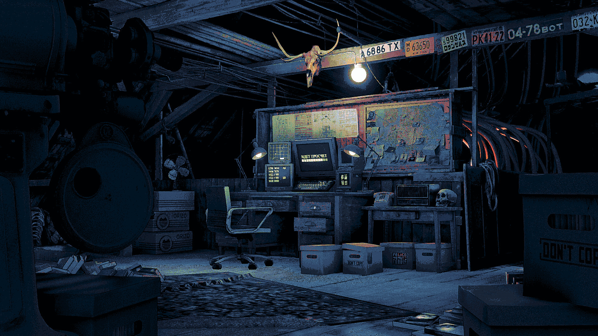
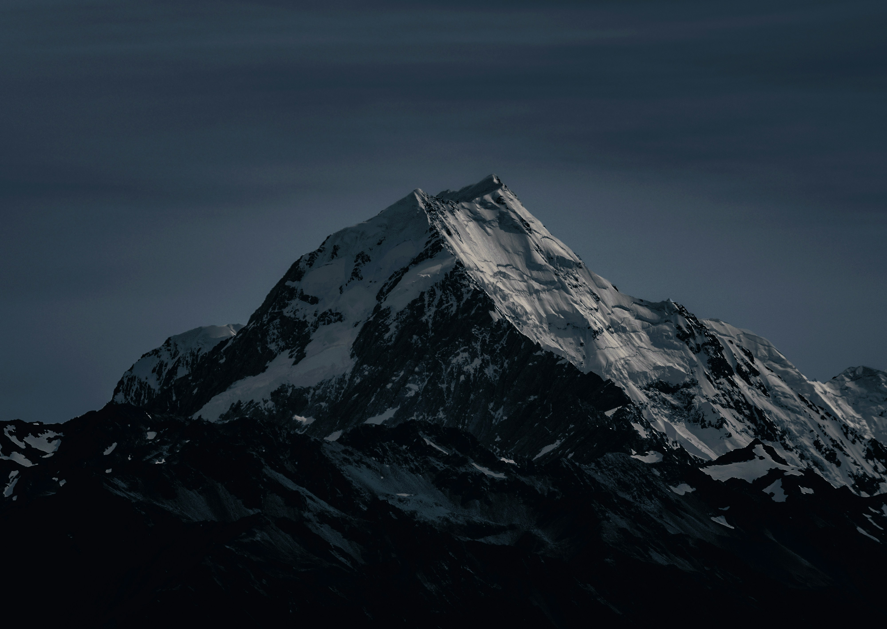

# wallpapers

A hand-picked wallpaper collection, sorted by what is in the image and then by
colour, so every folder flows from one palette into the next.

`194` images &middot; `455 MB` &middot; `15` categories &middot; last rebuilt `2026-10-27`

Browse the gallery: **[spreadsheets600.github.io/Wallpapers/](https://spreadsheets600.github.io/Wallpapers/)**

## categories

| preview | collection | images | size |
|---|---|---|---|
|  | **[Abstract](Wallpapers/Abstract/)** | 19 | 45.9 MB |
|  | **[Anime](Wallpapers/Anime/)** | 40 | 158.3 MB |
|  | **[City](Wallpapers/City/)** | 5 | 2.3 MB |
|  | **[Cyberpunk](Wallpapers/Cyberpunk/)** | 5 | 3.4 MB |
|  | **[Fantasy](Wallpapers/Fantasy/)** | 5 | 8.6 MB |
|  | **[Flowers](Wallpapers/Flowers/)** | 42 | 77.6 MB |
|  | **[Illustration](Wallpapers/Illustration/)** | 4 | 4.7 MB |
|  | **[Industrial](Wallpapers/Industrial/)** | 4 | 6.6 MB |
|  | **[Manga](Wallpapers/Manga/)** | 8 | 13.3 MB |
|  | **[Minimal](Wallpapers/Minimal/)** | 16 | 6.6 MB |
|  | **[Mountain](Wallpapers/Mountain/)** | 4 | 11.0 MB |
|  | **[Nature](Wallpapers/Nature/)** | 25 | 80.4 MB |
|  | **[Photography](Wallpapers/Photography/)** | 4 | 2.7 MB |
|  | **[Sea](Wallpapers/Sea/)** | 9 | 21.7 MB |
|  | **[Space](Wallpapers/Space/)** | 4 | 12.3 MB |

## layout

```text
Wallpapers/<Category>/<n>.<ext>   the images, numbered in colour order
index.html, styles.css            gallery generated by scripts/build_site.py
scripts/                          maintenance scripts
```

## adding wallpapers

```bash
git clone https://github.com/SpreadSheets600/Wallpapers.git
cd Wallpapers

# drop files into a category (or make a new folder)
cp ~/Downloads/*.jpg Wallpapers/Anime/

python3 scripts/organize.py     # HEIC -> JPEG, renumber loose files
python3 scripts/build_readme.py # refresh READMEs
python3 scripts/build_site.py   # refresh the gallery
git add -A && git commit -m "feat: add wallpapers" && git push
```

Sorting a new image into the right folder is manual on purpose: pick the
category it belongs to, then run `scripts/organize.py` to give it a number.

## credits

I do not own any of these images. Everything here belongs to the respective
artists and is collected for personal desktop use. If you are the owner of an
image and want it removed, open an issue and it will be taken down.
