# wallpapers

A wallpaper collection I actually use, curated over time, numbered in a stable order so the
gallery, the README and the folder always agree.

### `221` Images &middot; `651 MB`

**Gallery: [spreadsheets600.github.io/Wallpapers/](https://spreadsheets600.github.io/Wallpapers/)**

> [!NOTE] 
> The gallery is generated - GitHub Actions builds the
thumbnails, this README and the static site on every push and publishes them to
the `gh-pages` branch. Clicking a thumbnail on the site opens the full-size
image from this branch.

## Wallpapers

|  |  |  |  |
|---|---|---|---|
| <a href="Wallpapers/1.jpg"></a> | <a href="Wallpapers/2.jpg">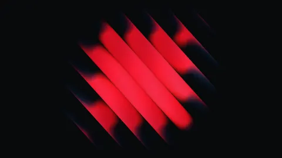</a> | <a href="Wallpapers/3.jpg"></a> | <a href="Wallpapers/4.jpg"></a> |
| <a href="Wallpapers/5.jpg"></a> | <a href="Wallpapers/6.jpg"></a> | <a href="Wallpapers/7.jpg"></a> | <a href="Wallpapers/8.png"></a> |
| <a href="Wallpapers/9.png"></a> | <a href="Wallpapers/10.jpeg"></a> | <a href="Wallpapers/11.png"></a> | <a href="Wallpapers/12.jpg"></a> |
| <a href="Wallpapers/13.jpg"></a> | <a href="Wallpapers/14.png"></a> | <a href="Wallpapers/15.png"></a> | <a href="Wallpapers/16.png"></a> |
| <a href="Wallpapers/17.png"></a> | <a href="Wallpapers/18.jpeg"></a> | <a href="Wallpapers/19.jpg"></a> | <a href="Wallpapers/20.jpg"></a> |
| <a href="Wallpapers/21.jpg">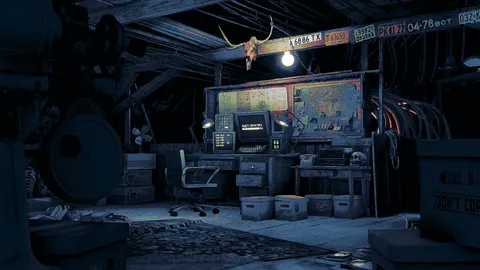</a> | <a href="Wallpapers/22.png">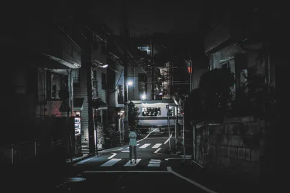</a> | <a href="Wallpapers/23.jpg"></a> | <a href="Wallpapers/24.jpg"></a> |
| <a href="Wallpapers/25.jpg"></a> | <a href="Wallpapers/26.jpg"></a> | <a href="Wallpapers/27.png"></a> | <a href="Wallpapers/28.png"></a> |
| <a href="Wallpapers/29.jpg"></a> | <a href="Wallpapers/30.jpg"></a> | <a href="Wallpapers/31.jpg"></a> | <a href="Wallpapers/32.jpg"></a> |
| <a href="Wallpapers/33.jpg"></a> | <a href="Wallpapers/34.png"></a> | <a href="Wallpapers/35.png"></a> | <a href="Wallpapers/36.jpg"></a> |
| <a href="Wallpapers/37.png"></a> | <a href="Wallpapers/38.jpg"></a> | <a href="Wallpapers/39.jpg"></a> | <a href="Wallpapers/40.jpg"></a> |
| <a href="Wallpapers/41.jpg"></a> | <a href="Wallpapers/42.jpg"></a> | <a href="Wallpapers/43.jpg"></a> | <a href="Wallpapers/44.png"></a> |
| <a href="Wallpapers/45.jpg"></a> | <a href="Wallpapers/46.png"></a> | <a href="Wallpapers/47.jpg"></a> | <a href="Wallpapers/48.jpg"></a> |
| <a href="Wallpapers/49.jpg"></a> | <a href="Wallpapers/50.jpg"></a> | <a href="Wallpapers/51.jpg"></a> | <a href="Wallpapers/52.jpg"></a> |
| <a href="Wallpapers/53.jpg"></a> | <a href="Wallpapers/54.jpg"></a> | <a href="Wallpapers/55.jpg"></a> | <a href="Wallpapers/56.jpg"></a> |
| <a href="Wallpapers/57.jpg"></a> | <a href="Wallpapers/58.png"></a> | <a href="Wallpapers/59.jpeg"></a> | <a href="Wallpapers/60.jpg"></a> |
| <a href="Wallpapers/61.jpeg">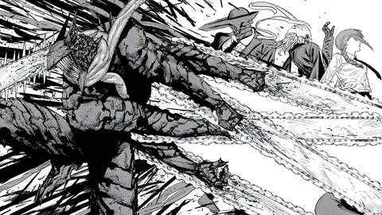</a> | <a href="Wallpapers/62.jpeg"></a> | <a href="Wallpapers/63.jpeg"></a> | <a href="Wallpapers/64.jpg">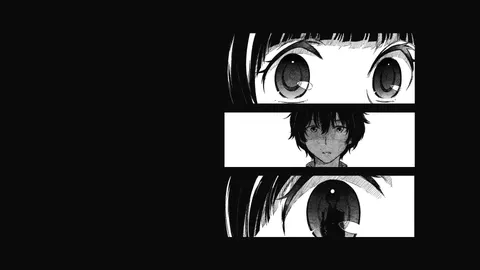</a> |
| <a href="Wallpapers/65.jpg"></a> | <a href="Wallpapers/66.jpg"></a> | <a href="Wallpapers/67.png"></a> | <a href="Wallpapers/68.png"></a> |
| <a href="Wallpapers/69.png"></a> | <a href="Wallpapers/70.png"></a> | <a href="Wallpapers/71.png"></a> | <a href="Wallpapers/72.png"></a> |
| <a href="Wallpapers/73.png"></a> | <a href="Wallpapers/74.png"></a> | <a href="Wallpapers/75.png">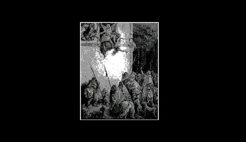</a> | <a href="Wallpapers/76.png"></a> |
| <a href="Wallpapers/77.jpeg"></a> | <a href="Wallpapers/78.jpg"></a> | <a href="Wallpapers/79.jpg"></a> | <a href="Wallpapers/80.jpg">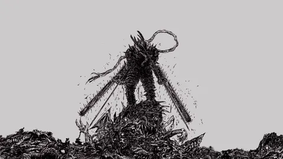</a> |
| <a href="Wallpapers/81.jpg"></a> | <a href="Wallpapers/82.jpg"></a> | <a href="Wallpapers/83.jpg"></a> | <a href="Wallpapers/84.jpg"></a> |
| <a href="Wallpapers/85.png"></a> | <a href="Wallpapers/86.jpeg"></a> | <a href="Wallpapers/87.jpg"></a> | <a href="Wallpapers/88.png">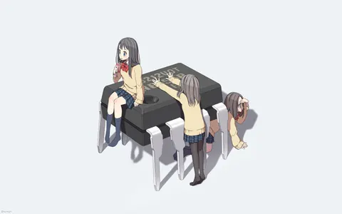</a> |
| <a href="Wallpapers/89.jpg"></a> | <a href="Wallpapers/90.png">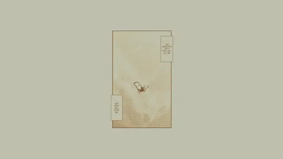</a> | <a href="Wallpapers/91.png"></a> | <a href="Wallpapers/92.jpg"></a> |
| <a href="Wallpapers/93.jpg"></a> | <a href="Wallpapers/94.jpg"></a> | <a href="Wallpapers/95.png"></a> | <a href="Wallpapers/96.jpg"></a> |
| <a href="Wallpapers/97.jpg"></a> | <a href="Wallpapers/98.png"></a> | <a href="Wallpapers/99.jpg"></a> | <a href="Wallpapers/100.jpg"></a> |
| <a href="Wallpapers/101.jpg">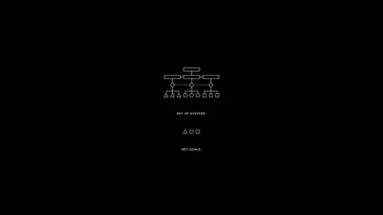</a> | <a href="Wallpapers/102.jpg"></a> | <a href="Wallpapers/103.jpg"></a> | <a href="Wallpapers/104.jpeg"></a> |
| <a href="Wallpapers/105.png"></a> | <a href="Wallpapers/106.png"></a> | <a href="Wallpapers/107.png"></a> | <a href="Wallpapers/108.jpg"></a> |
| <a href="Wallpapers/109.jpg"></a> | <a href="Wallpapers/110.jpg"></a> | <a href="Wallpapers/111.jpg"></a> | <a href="Wallpapers/112.jpg"></a> |
| <a href="Wallpapers/113.jpg"></a> | <a href="Wallpapers/114.jpg"></a> | <a href="Wallpapers/115.jpg"></a> | <a href="Wallpapers/116.jpg"></a> |
| <a href="Wallpapers/117.jpg"></a> | <a href="Wallpapers/118.jpg"></a> | <a href="Wallpapers/119.jpg"></a> | <a href="Wallpapers/120.jpg"></a> |
| <a href="Wallpapers/121.jpg"></a> | <a href="Wallpapers/122.jpg"></a> | <a href="Wallpapers/123.jpg"></a> | <a href="Wallpapers/124.jpg"></a> |
| <a href="Wallpapers/125.jpg"></a> | <a href="Wallpapers/126.jpg"></a> | <a href="Wallpapers/127.jpg">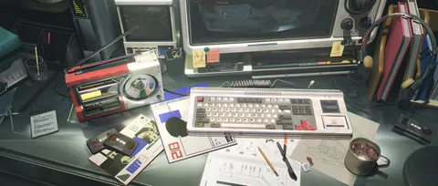</a> | <a href="Wallpapers/128.jpg"></a> |
| <a href="Wallpapers/129.jpg"></a> | <a href="Wallpapers/130.jpg"></a> | <a href="Wallpapers/131.jpg"></a> | <a href="Wallpapers/132.jpg"></a> |
| <a href="Wallpapers/133.png">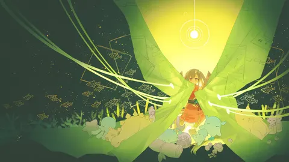</a> | <a href="Wallpapers/134.png">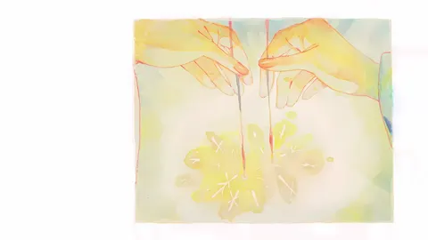</a> | <a href="Wallpapers/135.png"></a> | <a href="Wallpapers/136.jpg"></a> |
| <a href="Wallpapers/137.png">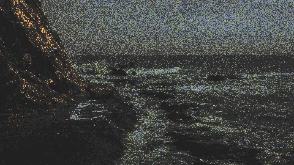</a> | <a href="Wallpapers/138.jpg">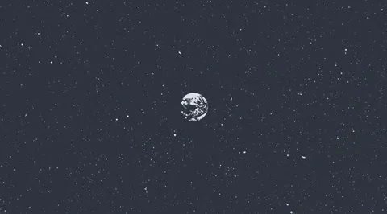</a> | <a href="Wallpapers/139.jpg"></a> | <a href="Wallpapers/140.png">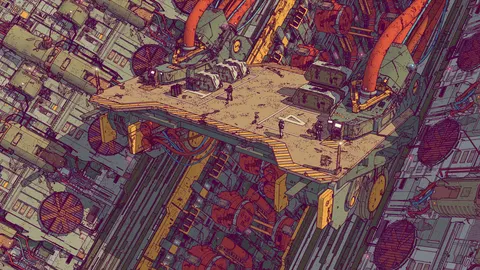</a> |
| <a href="Wallpapers/141.png"></a> | <a href="Wallpapers/142.png"></a> | <a href="Wallpapers/143.png"></a> | <a href="Wallpapers/144.png"></a> |
| <a href="Wallpapers/145.png"></a> | <a href="Wallpapers/146.png"></a> | <a href="Wallpapers/147.png"></a> | <a href="Wallpapers/148.png"></a> |
| <a href="Wallpapers/149.jpg"></a> | <a href="Wallpapers/150.jpg"></a> | <a href="Wallpapers/151.jpg"></a> | <a href="Wallpapers/152.jpg">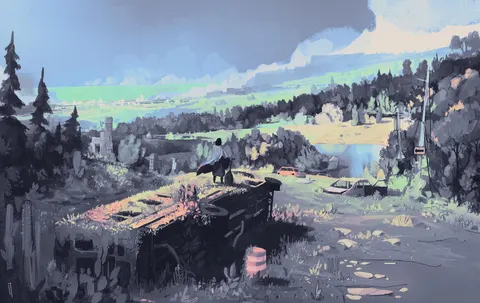</a> |
| <a href="Wallpapers/153.png">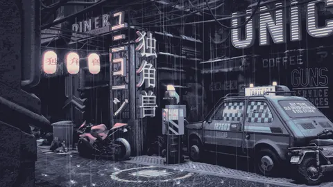</a> | <a href="Wallpapers/154.png">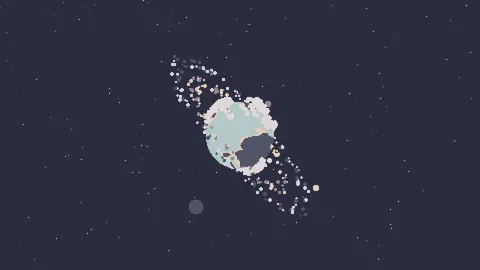</a> | <a href="Wallpapers/155.png">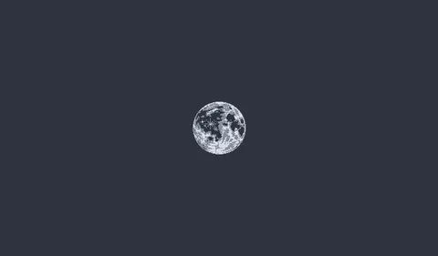</a> | <a href="Wallpapers/156.jpg"></a> |
| <a href="Wallpapers/157.jpg"></a> | <a href="Wallpapers/158.jpg"></a> | <a href="Wallpapers/159.jpg"></a> | <a href="Wallpapers/160.png"></a> |
| <a href="Wallpapers/161.png"></a> | <a href="Wallpapers/162.png">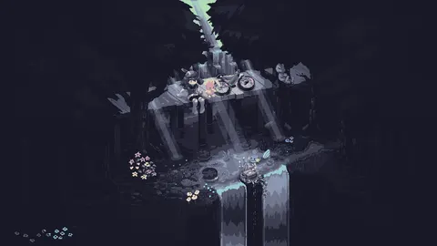</a> | <a href="Wallpapers/163.png"></a> | <a href="Wallpapers/164.jpg"></a> |
| <a href="Wallpapers/165.jpg"></a> | <a href="Wallpapers/166.png"></a> | <a href="Wallpapers/167.png"></a> | <a href="Wallpapers/168.png"></a> |
| <a href="Wallpapers/169.jpg"></a> | <a href="Wallpapers/170.webp"></a> | <a href="Wallpapers/171.webp"></a> | <a href="Wallpapers/172.jpg"></a> |
| <a href="Wallpapers/173.jpg"></a> | <a href="Wallpapers/174.png">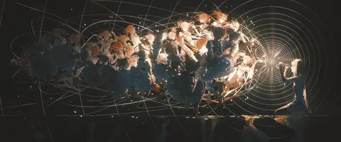</a> | <a href="Wallpapers/175.png"></a> | <a href="Wallpapers/176.png"></a> |
| <a href="Wallpapers/177.jpg"></a> | <a href="Wallpapers/178.jpg"></a> | <a href="Wallpapers/179.jpg"></a> | <a href="Wallpapers/180.png"></a> |
| <a href="Wallpapers/181.jpg">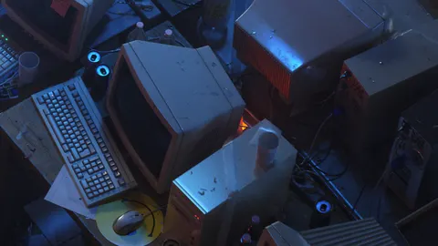</a> | <a href="Wallpapers/182.jpg"></a> | <a href="Wallpapers/183.png"></a> | <a href="Wallpapers/184.jpg"></a> |
| <a href="Wallpapers/185.png"></a> | <a href="Wallpapers/186.png"></a> | <a href="Wallpapers/187.jpg"></a> | <a href="Wallpapers/188.jpg"></a> |
| <a href="Wallpapers/189.png"></a> | <a href="Wallpapers/190.jpg"></a> | <a href="Wallpapers/191.png"></a> | <a href="Wallpapers/192.png"></a> |
| <a href="Wallpapers/193.jpg"></a> | <a href="Wallpapers/194.jpg">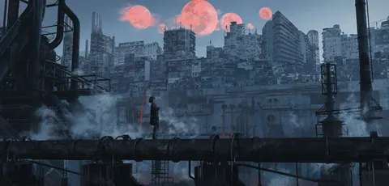</a> | <a href="Wallpapers/195.jpg"></a> | <a href="Wallpapers/196.jpg"></a> |
| <a href="Wallpapers/197.jpg"></a> | <a href="Wallpapers/198.jpg"></a> | <a href="Wallpapers/199.jpg"></a> | <a href="Wallpapers/200.png"></a> |
| <a href="Wallpapers/201.jpg"></a> | <a href="Wallpapers/202.jpg"></a> | <a href="Wallpapers/203.png"></a> | <a href="Wallpapers/204.jpg"></a> |
| <a href="Wallpapers/205.png"></a> | <a href="Wallpapers/206.jpg"></a> | <a href="Wallpapers/207.jpg"></a> | <a href="Wallpapers/208.png"></a> |
| <a href="Wallpapers/209.jpg"></a> | <a href="Wallpapers/210.jpg"></a> | <a href="Wallpapers/211.png"></a> | <a href="Wallpapers/212.png"></a> |
| <a href="Wallpapers/213.png"></a> | <a href="Wallpapers/214.png"></a> | <a href="Wallpapers/215.png"></a> | <a href="Wallpapers/216.png"></a> |
| <a href="Wallpapers/217.png"></a> | <a href="Wallpapers/218.png"></a> | <a href="Wallpapers/219.png"></a> | <a href="Wallpapers/220.png"></a> |
| <a href="Wallpapers/221.png"></a> |  |  |  |

## Adding Or Removing Wallpapers

```bash
git clone https://github.com/SpreadSheets600/Wallpapers.git
cd Wallpapers

# add or delete files under Wallpapers/
python3 scripts/organize.py      # HEIC -> JPEG, renumber loose files

git add -A && git commit -m "feat: add wallpapers" && git push
```

The push is all you need: the workflow regenerates the README, the thumbnails
and the site, commits the README back here and force-pushes a fresh `gh-pages`
branch.

To preview the site locally (Pillow or ImageMagick needed):

```bash
python3 -m pip install --user pillow
python3 scripts/build_site.py

python3 -m http.server -d _site 8000
```

## Credits

> [!NOTE] 
> I do not own any of these images. Everything belongs to the respective artists
and is collected for personal desktop use. If you own an image and want it
removed, open an issue and it will be taken down.
