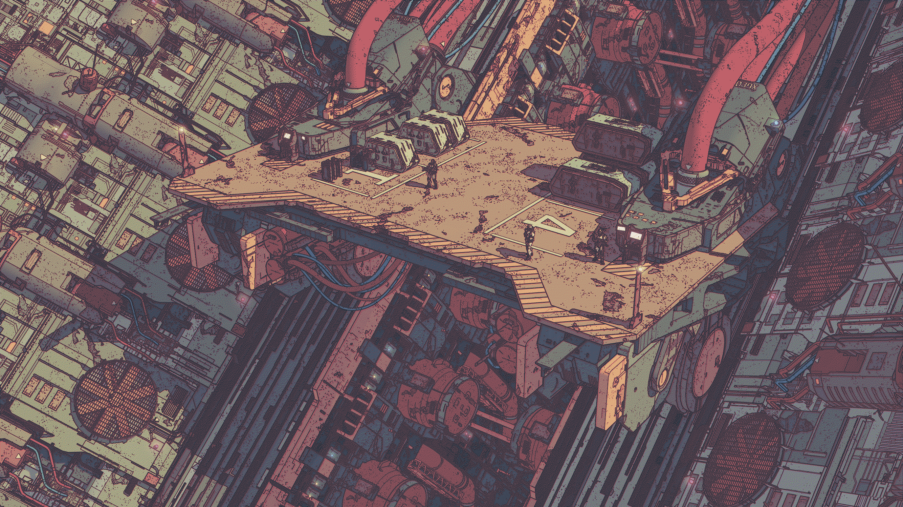
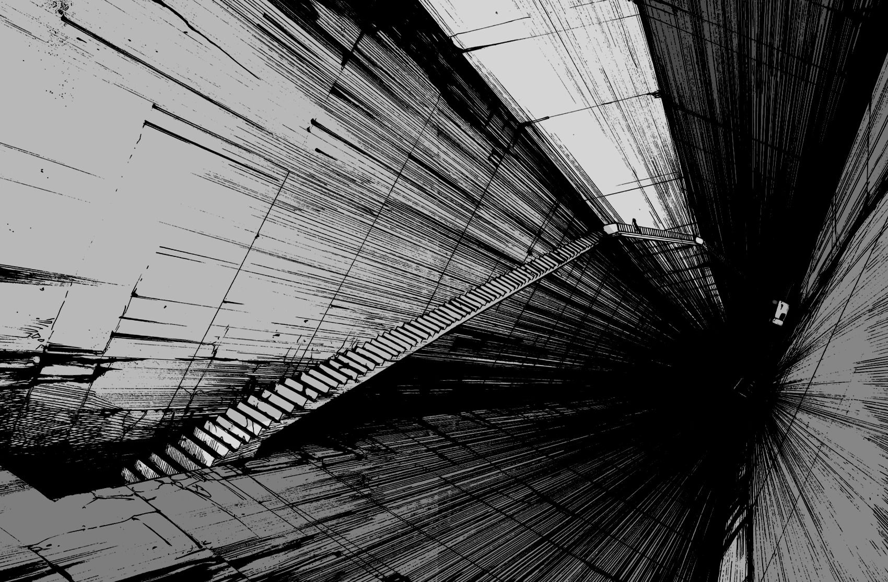
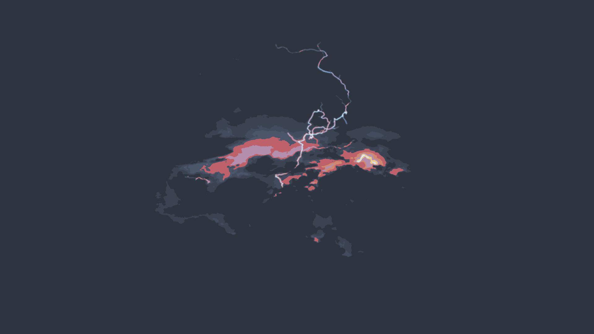
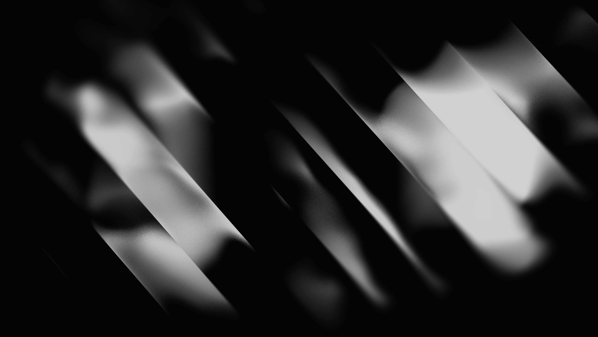
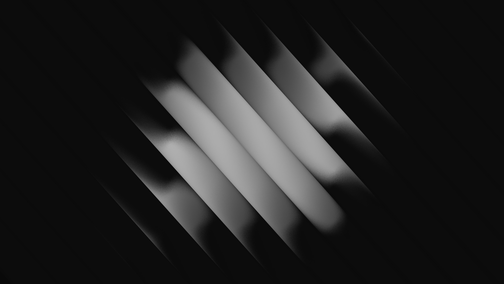
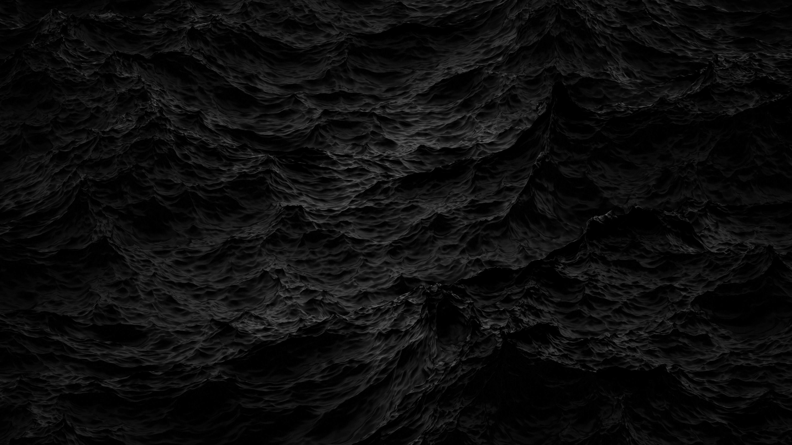

# Abstract

[&larr; all categories](../README.md)

`19` images &middot; `45.9 MB`

|  |  |  |  |
|---|---|---|---|
|  |  |  |  |
|  |  |  |  |
|  |  |  |  |
|  |  |  |  |
|  |  |  |  |

Every wallpaper belongs to its original creator. See the
[main README](../README.md#credits) for credits and takedown requests.
